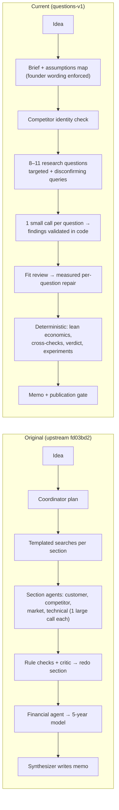

# AI Startup Co-Founder — Agent Development Progress

*Prepared 9 November 2026 for the project team. All figures below were recomputed from the repository, the upstream
Git history, backups and saved runs unless marked **historical**. File paths and methods are in the appendix.*

## Summary

- **Architecture changed from "fill report sections" to "test the founder's assumptions".** The current system
  (workflow `questions-v1`) restates the idea, maps the assumptions it depends on, answers 8–11 narrow research
  questions with one small model call each, validates every finding in code, and computes the economics, verdict and
  experiments deterministically. All of this is implemented and covered by 161 automated tests.
- **Report quality improved on measurable proxies.** On the same climbing-app idea, off-topic sources cited by claims
  fell from 67/99 (original workflow) to 0/36–0/49 (later runs); salaried-team five-year projections and
  stage-inappropriate churn/CAC experiments disappeared; the memo shrank from 3,500–5,000 words to 1,200–1,500 with no
  repeated sentences. On a 9-dimension rubric (one rater, 0–27) the Nov 6 report scores 6, the Nov 9 3B report 12 and
  the Nov 9 7B report 20.
- **3B vs 7B is only partly controlled.** The two Nov 9 runs used identical code and settings but live web search at
  different times. The 7B run made fewer unsupported "supported" claims and found more relevant competitors, but took
  4.5× longer (22 vs 5 minutes). One run each is not enough to call 7B better in general.
- **The main remaining problem is semantic correctness, not structure.** In the Nov 9 3B run a false claim
  ("climbers in Pittsburgh are willing to pay") passed every automated check and reached the memo. Retries are
  measured honestly but fixed nothing in either Nov 9 run (0 of 4 repairs improved). Feasibility, competitor
  complaints and local market size were not answered in any run.

## 1. Objective

Turn a founder's one-sentence idea into an evidence-based decision report — is the problem real, who has it, would
they pay, who competes, is it feasible, what could kill it, what to test next — running locally on an 8 GB M3 Mac
with qwen2.5 3B or 7B through Ollama and free web search.

## 2. Baseline and timeline

| Stage | Code | Saved run used here | What changed (confirmed in source) |
|---|---|---|---|
| **Original** | upstream `srivathsanb14/ai-startup-cofounder` @ `fd03bd2` (3 Nov) — 2,650 lines, 47 tests | — | Coordinator → templated searches per section → one extraction call per section (customer, competitor, market, technical, extras) → rule + critic review with redo → financial assumptions → deterministic 5-year model → synthesizer → evidence grade and verdict cap |
| **Intermediate (Nov 5)** | original + time budget, token caps, speed fix — 2,737 lines, 52 tests (`backups/project-snapshot-20261106.tgz`) | `assessment-20261105-155236-096579` (3B) | Run-time controls only; agent logic unchanged |
| **Adaptive-v2 (Nov 6)** | 5,491 lines, 91 tests (`project-snapshot-20261106-1500.tgz`) | `assessment-20261106-140151-696771` (3B, 10 min) | Relevance frame, bounded adaptive research, competitor identity check, claim records with verifier, issue tracker with measured retries, financial-input validation, final review |
| **Report v3 / v3.1 (Nov 6–9)** | 7,784 lines, 126 tests | Nov 6 run re-rendered | Decision memo + appendix, substance checks, source credibility/independence, publication gate |
| **Questions-v1 / report-v4 (Nov 9)** — current | 9,911 lines, 161 tests | `full-20261109-141200` (3B, 5 min), `full-7b-20261109-142628` (7B, 22 min) | Research-planning agent, question-scoped analysts, per-question repair, stage-appropriate economics, deterministic synthesis and experiments |

The upstream repository was recoverable, so "original" means the actual upstream code. The Nov 5 run is the closest
saved output from it (upstream logic plus run-time controls).

## 3. Architecture: before and after

**What already existed upstream** (credit where due): a shared evidence ledger with source IDs, schema-constrained
JSON extraction, checkpoints, a lexical grounding check, a critic review loop, a deterministic five-year model and a
verdict cap.

**Confirmed changes since then**

| Change | Mechanism (file) | Why it matters |
|---|---|---|
| Preserve the founder's idea | Restatement rejected if it adds concept-changing words; stage never upgraded; geography only if stated (`brief.py`) | Stops "partner app" drifting into "stranger-matching marketplace" |
| Hypothesis-based planning | Desirability/viability/feasibility hypotheses ranked by importance (`brief.assumptions_map`) | Research aims at what decides the idea, not at a report template |
| Smaller model calls | One question → one call with ≤6 evidence items, ~450 reply tokens (`analyst.py`, `tokens.py`) | Fits a 4,096-token window; a 3B model does one job at a time |
| Question-specific retrieval | Per-question queries by source type plus a disconfirming query; ≤2 items per website (`questions.py`, `analyst.packet`) | Forums for pain, vendor pages for prices; one site cannot dominate |
| Relevance, credibility, independence, recency | Category frame gate; source typing; vendor-only flags; dated stats capped (`relevance.py`, `validators.py`) | Off-topic citations fell to zero |
| Competitor identity | Name + category co-occurrence, official domain, direct/substitute/adjacent (`identity.py`) | Removes "competitors" that are unrelated companies |
| Claim tracking | Claim records with lexical screen, model check with control probe, downgrade-only rescreen (`claims.py`) | Every published statement has a status and source |
| Finding-level rules | Product text is not customer evidence; vendor price is not willingness to pay; non-local market data is context only (`analyst.validate`) | Fixes the "Climbing Buddy users" segment error |
| Targeted retries | Only the failing question, different sources, kept only if status/independent evidence improves (`pipeline._run_questions`) | No more "improved" labels on unchanged output |
| Deterministic economics | MVP cost, monthly costs, break-even volume, funding to milestone for solo/part-time/venture; 5-year model only if inputs are evidence-based (`economics2.py`) | No automatic four-person payroll |
| Cross-section synthesis | Rules X1–X8 (free alternatives vs price, cold start, unknown market vs break-even…), conditional verdict, experiments chosen by importance × weakest evidence (`synthesis.py`) | Conclusions cannot contradict the numbers; experiments fit the stage |
| Publication checks | Every number in the memo traced to validated data; regex contradiction check (`memo_v4.gate_check`) | Numeric hallucinations blocked |

**Proposed but not implemented:** semantic (meaning-level) verification of decisive findings, question-level search
budgets, founder inputs (budget, time, team), marketplace (two-sided) templates, a controlled 3B/7B benchmark.

## 4. Before/after measurements (same idea, same yardstick)

All four runs were re-scored with the current validators and a fixed relevance frame (built from the Nov 6 plan).

| Metric | Nov 5 original | Nov 6 adaptive-v2 | Nov 9 3B (current) | Nov 9 7B (current) |
|---|---|---|---|---|
| Off-topic sources cited by claims | **67 / 99** | 0 / 49 | 0 / 36 | 0 / 43 |
| Main-report length (words) | 3,503 | 5,025 | 1,202 | 1,458 |
| Repeated sentences | 18 | 15 | 0 | 0 |
| Memo citations from vendor/app pages | 15% (of 61) | 38% (of 85) | 25% (of 8) | 0% (of 5) |
| Salaried roles / 5-year table in main report | yes / yes | yes / yes | no / no | no / no |
| Experiments with pass thresholds | 0 | 0 | 1 | 3 |
| Stage-inappropriate validation (churn, CAC) | no | yes | no | no |
| Retries: labelled improved / actually improved | 9 labelled "improved" (historical: none fixed) | 1 retry, "no progress", stopped | 0 / 2 | 0 / 2 |
| False or contradicting statements in final report | 160% margin, 10,000 customers (2+) | break-even "within 5 years" vs model "none" (2) | false WTP claim, non-local problem claim (2) | evidence levels overstated (2) |
| Model calls / run time | not recorded | 40 / 10 min | 25 / 5 min | 26 / 22 min |

Notes: "off-topic" uses the same relevance gate for all runs (feasibility and safety questions, which legitimately
cite non-climbing sources, are excluded for Nov 9). Earlier summaries quoted 0/51 for Nov 6; the current recount is
0/49. "Wrong competitors 5/6" (historical) is better described as: 5 of 6 Nov 5 "verified" competitors cannot be
confirmed by the current identity check (they are logbook or training apps, one listed twice); see Example A for Nov 6.
Code and test counts grew (2,650 → 9,911 lines; 47 → 161 tests), but they measure effort, not report quality.

## 5. 3B vs 7B

**What was compared.** The requested pair (Nov 6 3B vs Nov 9 7B) differs in architecture *and* model. A second Nov 9
run with 3B on the same code makes it possible to split the two effects:

- Nov 6 3B → Nov 9 3B: same model, different architecture.
- Nov 9 3B → Nov 9 7B: same code and settings, different model — but live searches ran 14 minutes apart, and the
  model's own plan chose different search terms, so retrieved evidence differs.

**Rubric** (0 = wrong or misleading, 1 = weak or generic, 2 = adequate with gaps, 3 = specific and evidenced; scored by
one rater — the author of the system — from the reports and JSON):

| Dimension | Nov 6 3B | Nov 9 3B | Nov 9 7B |
|---|---|---|---|
| Understanding of the founder's idea | 1 | 2 | 3 |
| Customer segment and problem | 1 | 1 | 2 |
| Competitors | 1 | 1 | 2 |
| Market sizing and evidence quality | 0 | 1 | 2 |
| Technical feasibility | 1 | 1 | 1 |
| Financial realism and consistency | 0 | 1 | 2 |
| Business reasoning | 1 | 2 | 2 |
| Actionability of validation | 0 | 1 | 3 |
| Clarity and organisation | 1 | 2 | 3 |
| **Total (of 27)** | **6** | **12** | **20** |

**Likely architecture effects** (present in both Nov 9 runs, absent on Nov 6): verbatim idea, seven-section memo, lean
scenarios instead of a payroll model, conditional verdict, cold-start finding, stage-appropriate experiment templates,
no repetition, no off-topic citations.

**Plausibly model effects** (differ between the two Nov 9 runs on identical code):
- 3B accepted two claims its sources do not support; 7B answered "insufficient" where evidence was missing.
- 3B's planner invented founder exclusions ("outdoor climbers, beginners"); 7B added none.
- 7B's plan ("climbing partner matching app") led to six partner-finding competitors; 3B found one.
- 7B was 4.5× slower (1,322 s vs 295 s).

**Cannot be attributed:** competitor sets and economics depend on which pages the live search returned. The 3B
economics collapse (below) is a code bug triggered by the data it found.

**Not supported by this evidence:** "7B is better in general". It is one run per model, one idea, one rater.

**Controlled A/B proposal.** Freeze the evidence (the saved sources of both Nov 9 runs, 276 + 320, merged) with the existing
`eval/compare_workflows.py` FrozenWeb harness; same commit, settings and prompts; run 3B and 7B three times each;
score against a hand-labelled set of findings (supported / unsupported / contradicted) and the rubric, with a second
rater blind to the model. Estimated local compute: about 80 minutes (3 × 5 min + 3 × 22 min). Needs approval.

## 6. Three concrete examples

**A. Customers and competitors.** Nov 6 defined the customer segment as "Climbing Buddy users … who use Climbing Buddy
to find climbing partners", took willingness to pay from Climbing Buddy's own pricing, and listed *The Climbing
Place — Fayetteville, NC's premier indoor climbing facility* among the top 3 competitors. Nov 9 7B keeps the
founder's segment (adult indoor climbers in Pittsburgh), cites Reddit threads and Meetup groups as current workarounds,
and lists six partner-finding apps (Gora, ClimbingLoop, onBelay, Oak, ClimbTime, Mountain Project Partner Finder).
*Still missing:* no Pittsburgh-specific demand evidence, no prices or user complaints for any competitor, Climbing
Buddy not found, and onBelay's "direct" label conflicts with the run's own finding that its site does not mention
partners. *Counter-example:* the Nov 9 3B run on the same code reported "climbers in Pittsburgh are willing to pay"
from a Reddit post by someone seeking *outdoor* partners — a false claim that passed every automated check.

**B. Financial analysis.** Nov 6 modelled a product manager, two developers and a designer from year 1, $210.5K
start-up costs and a **$2.5M peak funding need**, while its executive summary claimed "a break-even period within
5 years" that its own table did not show. Nov 9 7B models three lean scenarios: a bootstrapped solo founder needs
about **35 paying (873 active) users** to cover $150/month and **≈$3.3K** to reach the next milestone; the $8/month
price is labelled a placeholder and no five-year table is shown. This is the right structure for an idea-stage
startup — it asks how much it costs to learn, not what revenue will be in year 5 — but price, 4% paying share and
costs are rules of thumb, not validated inputs. *Counter-example:* the Nov 9 3B run treated a one-time $2.99 app
price as monthly, producing **90,362 active users** to break even, yet still called the economics "small but
reachable".

**C. Recommendations.** Nov 6 recommended validating growth rate, churn and CAC for a product with no users. Nov 9 7B
names local density as the central risk and proposes a single-gym pilot (≥30 weekly participants, ≥50% of requests
matched, ≥30% return in week 3; $100–300; 4 weeks), a fake-door price test and a bottom-up count of gym members, each
with a decision rule. This tells the founder what to do this month and when to stop. *Caveat:* thresholds are
heuristics, and because 7B rated the problem "supported", problem interviews were dropped from the plan — arguably the
wrong first step.

## 7. Remaining limitations

**Confirmed failures (observed in the Nov 9 runs)**
1. *Meaning is not verified.* Lexical checks and the publication gate (numbers only) let false or non-local claims through, and the 7B run labelled the problem "supported" on the strength of competitor pages.
2. *Detection without correction.* 0 of 4 repairs improved; the search budget was spent (43 of 45) before the last questions ran.
3. *Coverage gaps.* Feasibility, competitor complaints, failure cases and local market counts were "not found" in both runs; feasibility searches returned off-domain pages (e.g. astrology "matching" APIs).
4. *Economics input bugs.* One-time prices are read as monthly, and adjacent apps' prices are used.
5. *Smaller defects.* Planner-invented exclusions bypass the fidelity check; rendering glitches (empty "Why ()", a reference to a missing Experiment 2); the v4 JSON's top-level `workflow` field still says `adaptive-v2`.

**Risks and hypotheses (not yet shown)**
- Results may not generalise beyond the climbing idea: the second concept was tested only on stub data.
- The validator benchmark (77 cases) was labelled by the system's author.
- Economic defaults and experiment thresholds may be wrong for other markets.
- 7B is near the memory limit of an 8 GB Mac at a 4,096-token context.

## 8. Next milestones (prioritised)

| Priority | Improvement | Why first | Effort | Success measure |
|---|---|---|---|---|
| 1 | **Meaning-level check of decisive findings**: one short verification call per finding that sets a hypothesis level (quote + supports/contradicts/irrelevant); geography mismatch and payment-free text excluded from support | Largest source of wrong conclusions in current runs | Medium; ~6 extra small calls per run | False "supported" labels on a hand-labelled set of Nov 9 findings below 10%; 0 false claims in A/B memos |
| 2 | **Question-level search budget and better sources**: reserve searches per question by priority, app-store reviews for complaints, documentation/GitHub for feasibility, dedupe passages | Explains most "not found" answers and failed repairs | Medium | Questions answered with independent evidence: from 2–4 of 11 to ≥6 of 11; repairs that improve > 0 |
| 3 | **Economics input hygiene**: parse one-time / per-session prices, use only direct or substitute prices, flag break-even volumes above any plausible local market | Small fix that prevents absurd outputs | Low | Zero unit errors on a labelled list of price strings; no break-even above 10× the bottom-up count |

**Milestone M5 — "evidence-correct v4":** on frozen evidence for the climbing idea and one second real idea, three runs
per model, with zero false "supported" labels on decisive hypotheses, at least 6 of 11 questions answered with
independent evidence, and the same verdict in at least 2 of 3 repeats.

---

## Appendix

### A. Sources of every figure

| Item | Location |
|---|---|
| Upstream code | `https://github.com/srivathsanb14/ai-startup-cofounder`, commit `fd03bd2` (6 commits, 28 Oct–3 Nov 2026) |
| Nov 5 code | `backups/project-snapshot-20261106.tgz` (snapshot taken before the 6 Nov reliability work; upstream + `budget.py`, token/speed edits) |
| Nov 6 code | `backups/project-snapshot-20261106-1500.tgz` (`WORKFLOW_VERSION = "adaptive-v2"`) |
| Current code | project folder; v4 modules `brief.py`, `questions.py`, `analyst.py`, `economics2.py`, `synthesis.py`, `report_v4.py`, `memo_v4.py` |
| Runs | `outputs/assessment-20261105-155236-096579.{md,json}`, `outputs/assessment-20261106-140151-696771.{md,json}`, `outputs/full-20261109-141200.{md,json}`, `outputs/full-7b-20261109-142628.{md,json}` |
| Run settings | `run_info` in each JSON (Nov 5 has none). Nov 9 runs: identical except model, timeout (240 vs 480 s) and ceiling (60 vs 90 min); both 45 searches / 16 fetches, 4,096-token context, `MAX_WORKERS=1` |

### B. Methods

- **Lines of code:** all `*.py` under `startup_cofounder/`; **tests:** `def test_` functions in `tests/`.
- **Off-topic cited sources:** unique source IDs cited by claim records (Nov 5: claims rebuilt from saved findings
  with `claims.claims_from_findings`), labelled by `RelevanceBook` with a frame built from the Nov 6 plan. Nov 9
  excludes questions Q-F1, Q-F2, Q-D2 and Q-K2, whose sources are judged by question fit, not category.
- **Memo metrics:** `eval/report_rubric.py` functions applied to the four main reports; vendor domains from all four
  runs' competitor lists.
- **Retry outcomes:** `review_log` (Nov 5/6) and `report.repairs` (Nov 9).
- **False statements:** Nov 5 and Nov 6 from `python -m startup_cofounder.audit` (current checker) plus reading the
  report; Nov 9 by reading each claim against its cited snippet. Example: Q-W1 in the 3B run cites E121, "26 (M)
  looking to find climbing partners around Pittsburgh for outdoor climbing" — no mention of payment.

### C. Question outcomes, Nov 9

| Question | 3B status | 7B status |
|---|---|---|
| Q-C1 problem and frequency | answered (claim about Pittsburgh from non-Pittsburgh sources) | partial |
| Q-C2 current workarounds | answered | answered |
| Q-W1 willingness to pay | answered (false) | insufficient |
| Q-R1 revenue models | insufficient | insufficient (vendor-only findings) |
| Q-M1 local market count | insufficient | insufficient |
| Q-D1 channels | answered (vendor + forum) | insufficient (findings not local) |
| Q-F1 technical components | insufficient (off-domain APIs in packet) | insufficient |
| Q-X1 failure cases | insufficient | insufficient |
| Q-K2 competitor complaints | insufficient (repair failed) | insufficient (repair failed) |
| Q-D2 cold start | insufficient | insufficient (search budget) |
| Q-F2 trust and safety | insufficient (search budget) | insufficient (search budget) |

### D. Competitor lists

| Run | Listed | Assessment |
|---|---|---|
| Nov 5 | KAYA, Gora, SENDO, LogSent, Lattice, Kaya App — all "verified" | Current check confirms only Gora; others are logbook/training apps; KAYA listed twice |
| Nov 6 | Gora (direct), Climbing Buddy (saved as adjacent), Climbing Place, LogSent, Crimpd, Vertical-Life | Climbing Place is a gym in Fayetteville, NC — not a competitor; Climbing Buddy is a direct competitor |
| Nov 9 3B | Gora (direct), forums (substitute); SENDO, Kaya, LogSent, Lattice (adjacent) | Adjacent labels correct; Gora's description copies the founder's idea text; partner apps missed |
| Nov 9 7B | Gora, ClimbingLoop, onBelay, Oak, ClimbTime, Mountain Project Partner Finder (all direct) | Partner-finding focus correct; prices absent; Climbing Buddy missed; not manually verified |

### E. Rubric evidence (abridged)

- **Idea:** Nov 6 added "structured training programs" from a competitor's Pro plan to the MVP; Nov 9 3B showed
  planner-invented exclusions as the founder's.
- **Financial:** Nov 6 break-even contradiction confirmed by `audit` (`synthesizer:break-even-contradiction`, two
  places); Nov 9 3B price $2.99 from LogSent ("$2.99 once"), contribution ≈$0.04/month.
- **Actionability:** Nov 9 3B produced one experiment because flawed "supported" labels removed the pilot and pricing
  tests.
- **Clarity:** Nov 9 3B has an empty "Why ()" and refers to a non-existent Experiment 2.
